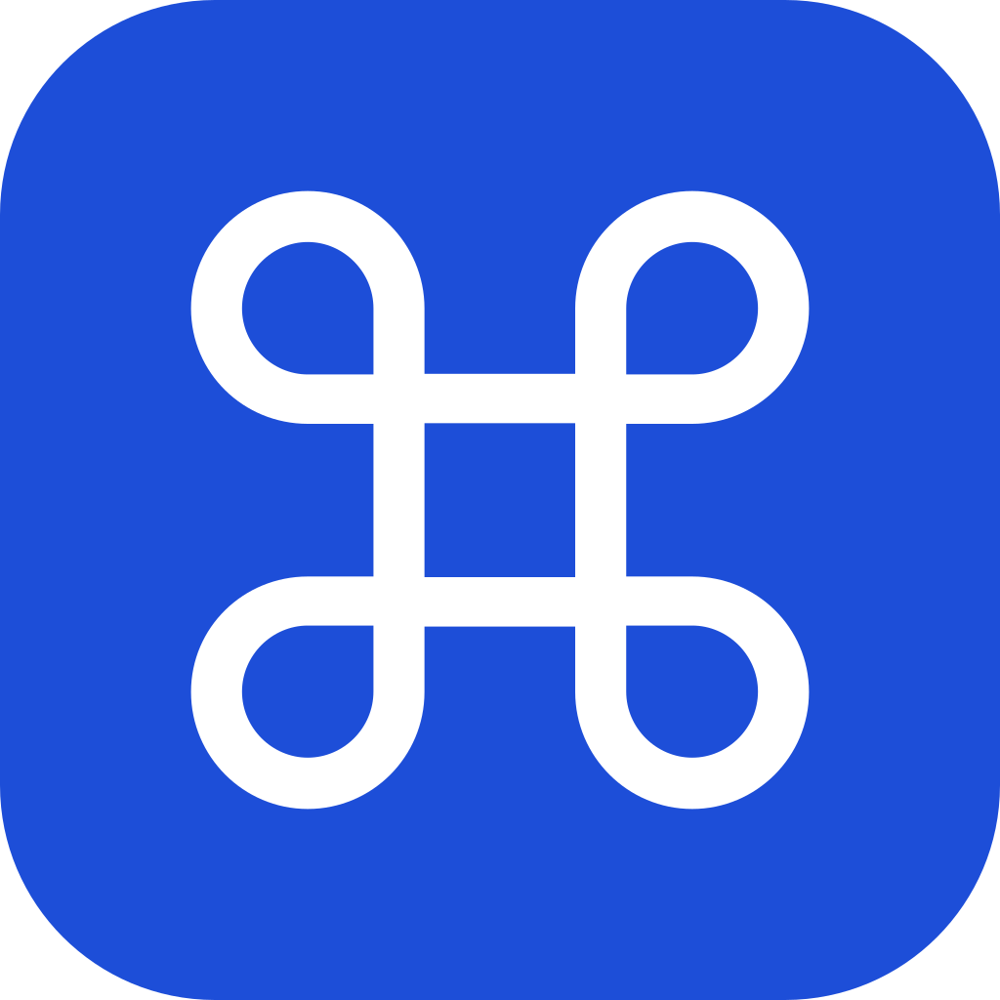
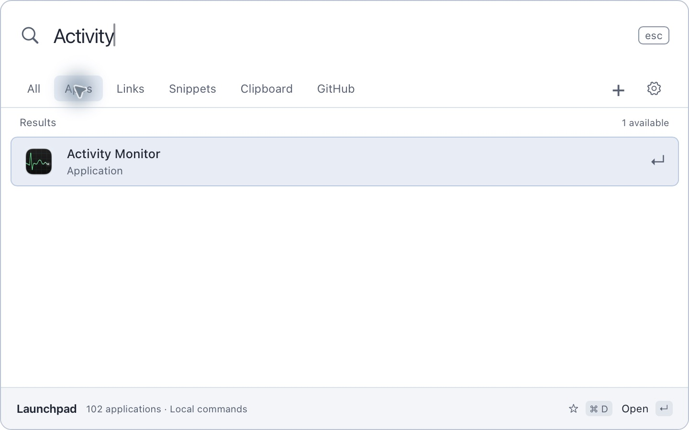
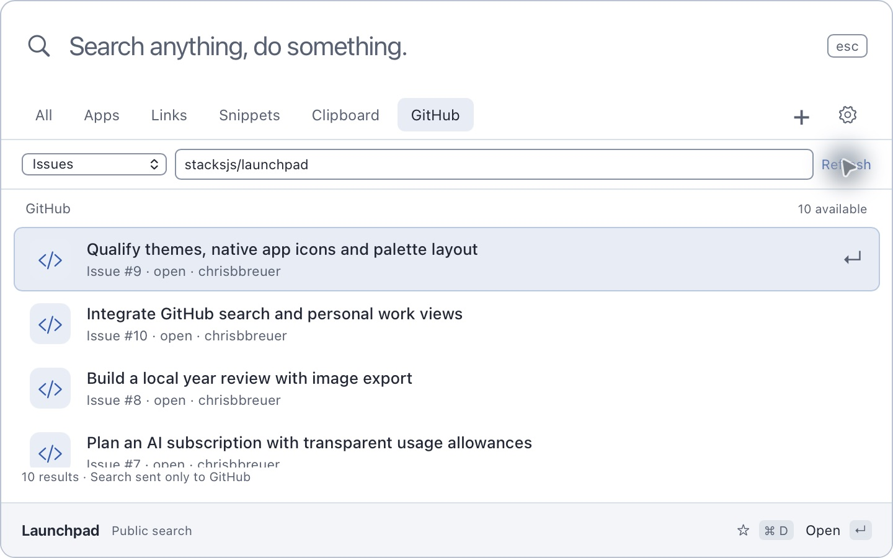
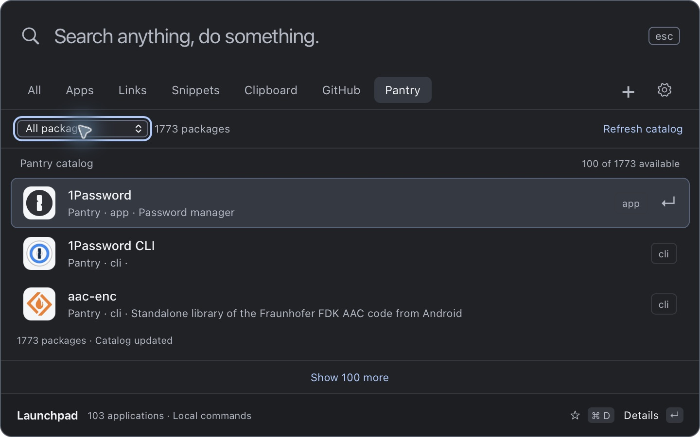

<p align="center">
  
</p>

<h1 align="center">Launchpad</h1>

<p align="center">
  Your apps, links and tools. One keyboard shortcut.<br>
  A free, native macOS launcher built with Stacks, stx and Craft.
</p>

<p align="center">
  <a href="https://launchpad.stacksjs.com">Website</a> ·
  <a href="https://github.com/stacksjs/launchpad/releases/latest">Download for Mac</a> ·
  <a href="#get-started">Get started</a> ·
  <a href="#development">Development</a> ·
  <a href="https://github.com/stacksjs/launchpad/issues">Issues</a>
</p>

<picture>
  <source media="(prefers-color-scheme: dark)" srcset="assets/screenshots/applications.jpg">
  <source media="(prefers-color-scheme: light)" srcset="assets/screenshots/applications-light.jpg">
  
</picture>

<p align="center"><sub>Real app icons, light and dark appearance, and a palette that stays out of your way.</sub></p>

## Get started

**Requires macOS 13 or later on an Apple Silicon Mac.** Bun is needed for development, not for running the installed app.

With [Pantry](https://pantry.dev) 0.11.142 or later:

```sh
pantry install launchpad
```

Or [download the latest release](https://github.com/stacksjs/launchpad/releases/latest), open the disk image, and install Launchpad. Public direct-download builds are signed and notarized.

Open Launchpad once, then press **Command + Space** from another app to start typing. Use the arrow keys to select a result and Return to open or copy it. Escape or clicking outside dismisses the palette.

Launchpad lives in the menu bar with no Dock or app-switcher icon. First launch opens General settings, where you can opt into **Launch at login**. Later starts stay hidden until you open the palette. Click the Command symbol to open it, or right-click for Open, Settings and Quit.

If another launcher owns Command + Space, quit it or reassign its shortcut before opening Launchpad.

## What you can do

| Tool | What it does |
| --- | --- |
| **Applications** | Find and open installed apps with their real macOS icons. New installations are discovered when the palette opens and while it stays visible. |
| **Search** | Prioritize names and genuine aliases. Favorites and recent use refine relevant results; compact abbreviations such as `vsc` and `sst` still work. |
| **Quicklinks** | Save websites or search templates such as `https://example.com/?q={query}`, then use a named alias with your search argument. |
| **Snippets** | Keep reusable text close and copy it with Return. |
| **Calculator** | Calculate locally with parentheses, powers and percentages, then copy the answer. |
| **Clipboard History** | Search and preview saved text, with opt-in recording, retention controls and individual deletion. |
| **GitHub** | Search repositories, issues and pull requests, or check assigned issues, review requests and notifications. |
| **Pantry** | Browse apps, CLI tools, libraries and fonts, inspect upstream details, and request installs from the Pantry CLI. |
| **Local usage** | See app sessions, palette time, app and link opens, commands and Pantry install totals. These records prepare for a future year review. |
| **Appearance** | Choose System, Light or Dark in Settings. |

**All shows your installed tools.** Installed Pantry packages sit alongside Mac apps and saved commands. The Pantry tab shows the full discovery catalog. Ordinary launcher search matches package identities; descriptions are searchable on the Pantry page.

## GitHub and Pantry

| GitHub | Pantry |
| --- | --- |
|  |  |

### GitHub

Public repository search works without signing in. Choose a view and optionally narrow the scope to `owner/repository`. Connect a personal access token in Settings for account features and authorized private resources. The token stays in macOS Keychain and can be removed by disconnecting.

GitHub searches go to GitHub's API. Your app, snippet and clipboard searches stay on your Mac.

### Pantry

You can browse the catalog before connecting the installer. To install through Launchpad, set up [Pantry](https://pantry.dev)'s local desktop service:

```sh
pantry desktop setup --yes
```

Open **Settings → Pantry** and enter the single-use pairing code. Launchpad stores the connection token in macOS Keychain. Package details show original logos, upstream links, installed versions and job status. The separately installed Pantry CLI performs installations under your user account.

## Keyboard shortcuts

| Shortcut | Action |
| --- | --- |
| <kbd>⌘</kbd> <kbd>Space</kbd> | Open Launchpad and focus search |
| <kbd>↑</kbd> / <kbd>↓</kbd> | Move through results |
| <kbd>Return</kbd> | Open or copy the selected result |
| <kbd>⌘</kbd> <kbd>Delete</kbd> | Clear the search |
| <kbd>⌘</kbd> <kbd>N</kbd> | Create a quicklink or snippet |
| <kbd>⌘</kbd> <kbd>D</kbd> | Toggle a favorite |
| <kbd>⌘</kbd> <kbd>E</kbd> | Edit the selected saved command |
| <kbd>⌘</kbd> <kbd>G</kbd> | Open GitHub search |
| <kbd>⌘</kbd> <kbd>Shift</kbd> <kbd>V</kbd> | Open Clipboard History |
| <kbd>⌘</kbd> <kbd>,</kbd> | Open Settings |
| <kbd>Escape</kbd> | Dismiss the palette |

Saved commands and clipboard entries have a separate Delete control. Command + Delete clears what you typed.

## Your data

Launchpad works without a Stacks account or hosted API. Its local SQLite database holds commands, preferences, favorites, clipboard entries and usage records in the macOS app container.

- **Clipboard recording is opt-in.** Keep up to 200 text entries with 1, 7 or 30 day retention. Protected pasteboard types are skipped, but unmarked sensitive text can still be captured. Pause recording before copying private material.
- **Usage stays local.** Inspect, pause or clear it in Settings. Search queries, URLs, file paths, clipboard text and snippet contents are excluded from activity records. Year-review image export is planned; the current app collects and summarizes the local records.
- **Credentials use Keychain.** GitHub and Pantry connection tokens are separate from the local database.
- **Connected services use the network.** GitHub receives GitHub searches. Catalog refreshes and logos come from Pantry's public sources; installations contact the registry and upstream providers through Pantry.
- **No cloud synchronization is enabled.** Local clipboard history and usage history have separate clear controls.

Read the [privacy policy](PRIVACY.md) and [local usage contract](docs/local-usage.md) for retention, metric definitions and API behavior.

## Development

Use an Apple Silicon Mac with macOS 13 or later and Bun 1.3 or later. Buddy provisions the immutable Craft runtime and toolchain declared in `pantry.json`.

```sh
git clone https://github.com/stacksjs/launchpad.git
cd launchpad
bun install --frozen-lockfile
./buddy dev
```

### Checks and builds

```sh
./buddy lint
./buddy typecheck
./buddy test
./buddy build
./buddy package
```

`bun run test:usage-native` additionally qualifies the compiled backend with the Pantry Craft runtime active, or an explicit `CRAFT_BIN` for development. It uses isolated fixtures for model persistence, timing and Pantry job receipts. `bun scripts/benchmark-search.ts` measures local search computation; see [performance notes](docs/performance.md).

### How it fits together

[Stacks](https://stacksjs.com) provides the model API and application tooling. [stx](https://github.com/stacksjs/stx) and ts-css render the interface; [Craft](https://github.com/home-lang/craft) supplies the native window, menu bar, global shortcut, application icons, clipboard and Keychain bridge. The backend ships with the app and uses an authenticated loopback session. Direct and Store packages use the macOS sandbox.

| Path | Responsibility |
| --- | --- |
| `resources/views/launcher.stx` | Native launcher interface |
| `resources/functions/` | Search, execution and native integrations |
| `app/Models/` | Local schema, validation and generated API definitions |
| `app/Desktop/` | Bundled API, discovery, clipboard and usage services |
| `resources/views/site/` | Marketing website |
| `assets/` | App icon sources, licensed fonts and real screenshots |
| `tests/` | Regression tests and API qualification |
| `craft.config.ts` | Native app and window configuration |
| `pantry.json` | Pinned runtime, checks and delivery targets |

Model definitions drive native schema upgrades. Keep application features in the Stacks model API and improve shared framework capabilities at their sources.

### Website and branding

```sh
./buddy dev --site
bun run build:site
```

The website builds separately to `dist/site` and is published at [launchpad.stacksjs.com](https://launchpad.stacksjs.com). The Stacks server's [site catalog](https://github.com/stacksjs/stacks/blob/main/config/cloud.ts) owns deployment. From the Stacks checkout, an authorized operator can deploy it with `./buddy deploy --prod --site launchpad --yes`.

The Command mark starts at `assets/brand/launchpad.svg`. `bun run generate:brand` renders the PNG and macOS icon set with ts-images and the native SVG renderer. `config/images.ts` defines the website's share cards, generated by `./buddy generate:images --social`. Builds reuse the shared mark and licensed Geist fonts.

### Releases

```sh
bun run release:patch
```

Release patch versions until the project policy changes. Buddy qualifies a clean `main` checkout and creates the version tag. [Pantry's reusable native workflow](https://github.com/pantry-pm/pantry/blob/main/.github/workflows/native-app.yml) handles runtime provisioning, signing, notarization, packaging and registry delivery. Apple packaging and submission also run through Buddy. App Store availability follows Apple's review and release process.

Release inputs are encrypted in `.env.production`; `.env.keys` remains private. Keep credentials and signing material out of source changes and issue reports.

## Contributing

Read [AGENTS.md](AGENTS.md), branch before editing `main`, and include a focused regression test for behavior changes. Run the relevant checks above and use conventional commit messages. Report bugs and propose features in [GitHub Issues](https://github.com/stacksjs/launchpad/issues); include your app version, macOS version and reproduction steps, without tokens or private clipboard contents.

The [v1 plan](docs/planning/v1.md), [research](docs/planning/research.md) and [changelog](CHANGELOG.md) document scope and shipped changes.

## License and credits

Launchpad declares the MIT license in [package.json](package.json). Bundled [fonts](assets/fonts/LICENSE.txt) and the [Command mark's source artwork](assets/brand/NOTICE.md) retain their respective notices.
